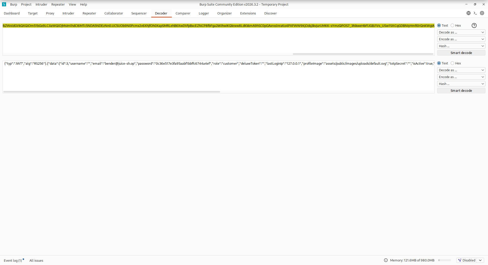
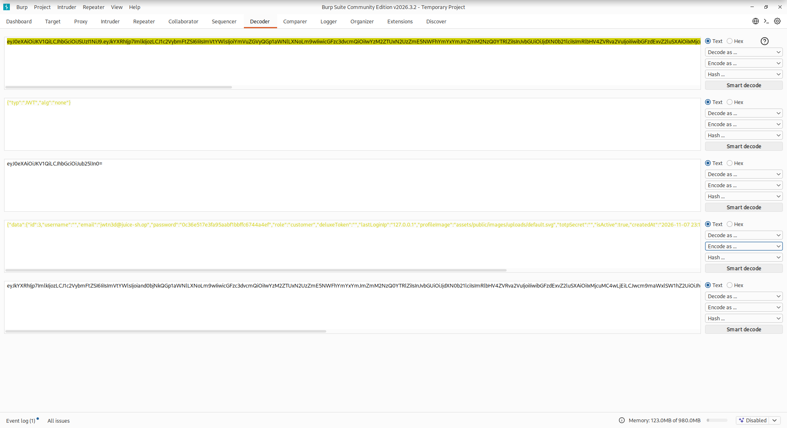

## The Short Version

<!-- 2 or 3 sentences. What the bug is, how you exploited it, and what the impact is. Recruiters often read only this part. -->

Juice Shop verifies the JWT but trusts the token's own `alg` header to decide how. By setting `alg` to `none` and dropping the signature, I forged a token for `jwtn3d@juice-sh.op`, a user that doesn't even exist, and the server accepted it as authentic. No signing key needed, just a token that tells the server not to check it.

| Field | Value |
|---|---|
| Category | Broken Authentication / Cryptographic Failures |
| Difficulty | 5/6 stars |
| OWASP Top 10 | A02:2021 Cryptographic Failures |
| CWE | CWE-347 Improper Verification of Cryptographic Signature |
| Tools | Burp Suite, jwt.io, browser DevTools |

## The Challenge

> Forge an essentially unsigned JWT token that impersonates the (non-existing) user `jwtn3d@juice-sh.op`.

So our goal here is to forge a JWT token (an unsigned one) to impersonate the user jwtn3d. Our job is to understand how the JWT is formed in order to forge it

## Reconnaissance

As a first step I logged in as a user (bender@juice-sh.op) and checked the cookies for the JWT, I then decoded the token (BASE64) to get the token structure

```json
// Decoded header
{
  "typ": "JWT",
  "alg": "RS256"
}
```

```json
// Decoded payload
{
  "data": {
    "id": "3",
    "email": "bender@juice-sh.op",
    "role": "customer"
    ...
  }
}
```



## Understanding the Signature

So the first part is the header which mentions the type of the token and the algorithm used to sign it (RS256 in this case). The second part is the payload where we can find the information related to the user. And the final part is the signature which is used to verify the validity or authenticity of the JWT

## Forging the Token

If we want to forge an unsigned token for this task we need to set the `alg` in the header to `none` because then there will be no signature to verify the token against.
I then changed the email to the email of the user we want to impersonate, jwtn3d@juice-sh.op.
Finally I encoded each part (BASE64) and joined them together separated with a '.' and of course there is no signature so the token ends in '.' (the signature is empty)
I then made a request to the server with the forged token to successfully pass this challenge

```http
GET /rest/user/whoami HTTP/1.1
Host: localhost:3000
Authorization: Bearer <FORGED_TOKEN>
```



## Root Cause

<!-- Why does the forgery work? The verifier accepts attacker-controlled "alg" and honors alg=none (or a weak/empty key), so a token with no valid signature is treated as authentic. -->

The whole thing breaks because the server lets the token decide how it should be verified. The `alg` header lives inside the JWT, which means it's fully attacker controlled, and the server reads it to pick the verification algorithm instead of pinning one itself. When you set `alg` to `none` the spec basically says "this token is unsigned so there is nothing to check", so the verifier just skips the signature step and trusts whatever is in the payload. We tell the server not to verify us and it happily listens, which is how a token with no valid signature ends up being treated as authentic.

## Impact

<!-- Full authentication bypass / identity spoofing: an attacker can mint a token for ANY user (even one that doesn't exist) without ever knowing a signing key. -->

This is a full authentication bypass. Since the signature never actually gets checked, an attacker can mint a token for any user they want without ever knowing the signing key. In my case I forged one for jwtn3d@juice-sh.op, a user that doesn't even exist, but the exact same trick works for any real account, including an admin. Change the email in the payload and you become that user, with everything their account can reach. No password, no key, no session to steal, just a forged token the server chose to trust.

## Remediation

<!-- Pin the accepted algorithm server side, never trust the token's own alg header, reject "none", verify with the correct public key/secret. -->

The fix is to stop letting the token pick its own verification. The server should pin the accepted algorithm on its side (RS256 here) and verify against that, instead of reading the `alg` header out of the token and trusting it. `none` should be rejected outright, a production verifier has no reason to accept an unsigned token. On top of that, make sure verification actually runs with the correct public key or secret and that a token failing the check is thrown out, not quietly let through. Most mature JWT libraries let you hand them an allow-list of algorithms exactly for this, so use it.

## Takeaways

- Never let the token decide how it gets verified, the `alg` header is attacker controlled and should never be trusted.
- `none` is a valid JWT algorithm, and that's exactly the problem, your verifier has to reject it explicitly.
- A signature that never gets checked is worse than no signature at all, it just gives a false sense of security.
- Always pin the algorithm server side and verify with the key you control, don't take the token's word for it.

## References

- [OWASP Juice Shop](https://owasp.org/www-project-juice-shop/)
- [OWASP Top 10 A02:2021](https://owasp.org/Top10/A02_2021-Cryptographic_Failures/)
- [CWE-347: Improper Verification of Cryptographic Signature](https://cwe.mitre.org/data/definitions/347.html)
- [RFC 7519: JSON Web Token (JWT)](https://datatracker.ietf.org/doc/html/rfc7519)
- [Critical vulnerabilities in JSON Web Token libraries (Auth0)](https://auth0.com/blog/critical-vulnerabilities-in-json-web-token-libraries/)
